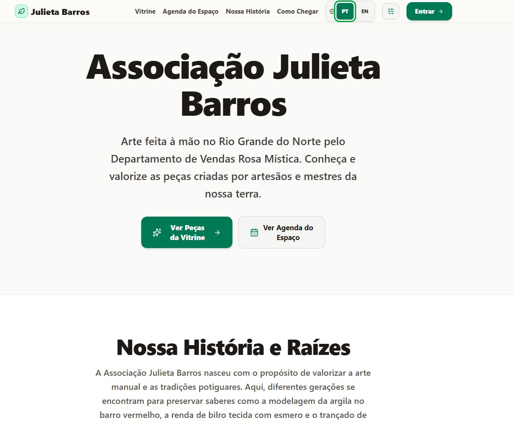

# Associacao Julieta Barros - Vitrine Digital e Gestao Comunitaria

[English Version](src/documents/READMEENG.MD)

Aplicacao web moderna (Frontend SPA) desenvolvida para a Associacao Julieta Barros e o Departamento de Vendas Rosa Mistica, localizada na Zona Norte de Natal/RN.

O projeto foi concebido para atender cooperativas locais de artesanato sob o modelo O2O (Online-to-Offline), priorizando acessibilidade para pessoas idosas, usabilidade objetiva e conformidade estrita com a LGPD (Lei Geral de Protecao de Dados).




---

## Sumario

- [Visao Geral](#visao-geral)
- [Tecnologias Utilizadas](#tecnologias-utilizadas)
- [Arquitetura e Conformidade](#arquitetura-e-conformidade)
- [Uso de Inteligencia Artificial e Sustentabilidade](#uso-de-inteligencia-artificial-e-sustentabilidade)
- [Etapas do Projeto](#etapas-do-projeto)
- [Como Executar Localmente](#como-executar-localmente)
- [Scripts Disponiveis](#scripts-disponiveis)
- [Acessibilidade e Usabilidade](#acessibilidade-e-usabilidade)

---

## Visao Geral

A solucao oferece uma vitrine digital para valorização de pecas artesanais e divulgaçãoo de cursos e oficinas comunitarias. A negociação  ocorre no meio fisico ou por canal direto via WhatsApp, evitando a sobrecarga de cobranca online intermediada e reduzindo a exposicao de dados de compradores.

---

## Tecnologias Utilizadas

### Frontend
- React 19
- TypeScript
- Vite 6
- Tailwind CSS v4
- React Router v7
- Lucide React
- Framer Motion
- Vite PWA (Service Worker customizado e operacao offline)

### Backend e Persistencia (Arquitetura Planejada)
- Python com Django e Django REST Framework
- PostgreSQL (Banco de dados relacional oficial)
- Autenticacao via JWT e sessoes com controle de acesso baseado em funcoes (RBAC)

---

## Arquitetura e Conformidade

- Desacoplamento Estrito: O frontend e 100% estatico e independente, comunicando-se exclusivamente por requisicoes HTTP REST em formato JSON.
- LGPD by Design: Nao ha coleta ou armazenamento de dados sensiveis de visitantes na camada publica.
- Persistencia Relacional: A estrutura de dados (artesaos, pecas, tecnicas, categorias e agenda de eventos) adota o modelo relacional via PostgreSQL, garantindo integridade referencial, consultas previsiveis e custo zero de leitura sob alta demanda.

---

## Uso de Inteligencia Artificial e Sustentabilidade

- Apoio de Inteligencia Artificial: Ferramentas de IA foram empregadas no suporte a prototipagem de interface (UI/UX), desenho de recursos de acessibilidade para a terceira idade, refinamento dos fluxos O2O e estruturacao modular dos componentes em React.
- Gestao de Riscos de Ausencia de Manutenção: Projetos comunitarios frequentemente enfrentam periodos prolongados sem equipe tecnica dedicada para manutencao continuada. As escolhas arquiteturais foram norteadas expressamente para mitigar esse risco:
  - Adocao de padroes abertos da web, eliminando dependencias de plataformas proprietarias fechadas que poderiam descontinuar servicos ou instituir cobrancas imprevistas.
  - A migracao definitiva para PostgreSQL e Django fundamenta-se na maturidade de mais de duas decadas, estabilidade e vasta documentacao dessas tecnologias, permitindo que futuros desenvolvedores ou voluntarios assumam o codigo sem barreiras proprietarias.
  - O frontend desacoplado garante que a vitrine publica continue estavel, leve e operacional mesmo em eventuais indisponibilidades ou manutencoes do servidor de backend.
- Vida Util e Resiliencia: A arquitetura prioriza longevidade operacional, facilidade de geracao de copias de seguranca (backups) e baixo custo de hospedagem, assegurando que o projeto permaneca util a comunidade por muitos anos com intervencao minima.

---

## Etapas do Projeto

### Etapa 1: Interface do Usuario e Experiencia (Concluida)
- [x] Prototipagem da identidade visual e fluxo Mobile-First.
- [x] Vitrine responsiva de produtos com indicacao de status (Disponivel/Vendido).
- [x] Modais informativos para contato direto via WhatsApp institucional ou artesao.
- [x] Agenda publica de eventos e oficinas comunitarias.
- [x] Painel de gestao com interfaces segmentadas por papel (Produtor, Gestor e Administrador).
- [x] Recursos avancados de acessibilidade (ajuste de fonte, alto contraste e sintetizador de voz).
- [x] Modo PWA com cache offline de produtos e paginas essenciais.

### Etapa 2: Implementacao do Backend e Banco de Dados (Fase Atual)
- [ ] Construcao da API REST com Django e Django REST Framework em Python.
- [ ] Configuracao e modelagem de tabelas no PostgreSQL:
  - Modelos de Usuarios e Perfis com RBAC (Administrador, Gestor, Produtor/Artesao).
  - Catalogo de Produtos e Tecnicas Artesanais.
  - Agenda de Cursos, Oficinas e Eventos do Espaco Comunitario.
  - Modulo de Auditoria e Logs de Acoes Administrativas.
- [ ] Autenticacao segura via tokens JWT e endpoints de sincronizacao de perfil.
- [ ] Ativacao do painel Django Admin para controle operacional interno da diretoria.
- [ ] Configuracao de armazenamento seguro para imagens e midias das pecas.

### Etapa 3: Integracao de Producao e Publicacao
- [ ] Conexao direta dos servicos do frontend (`src/services/djangoApi.ts`) com o backend Django.
- [ ] Homologacao dos fluxos de aprovacao de catalogo e atualizacao de status.
- [ ] Implantacao em ambiente de producao com servidor PostgreSQL dedicado.
- [ ] Automacao de backup continuo e monitoramento de saude via `/api/health`.

---

## Como Executar Localmente

### Pre-requisitos
- Node.js (versao 18 ou superior)
- npm ou gerenciador de pacotes equivalente

### Procedimento

1. Instale as dependencias do projeto:
   ```bash
   npm install
   ```

2. Inicie o servidor de desenvolvimento:
   ```bash
   npm run dev
   ```

3. Acesse a aplicacao no navegador:
   ```text
   http://localhost:3000
   ```

---

## Scripts Disponiveis

- `npm run dev`: Executa o servidor de desenvolvimento com Hot Module Replacement.
- `npm run build`: Gera a compilacao otimizada de producao no diretorio `dist/`.
- `npm run preview`: Executa localmente o build gerado em `dist/`.
- `npm run lint`: Valida tipos TypeScript sem emitir arquivos (`tsc --noEmit`).

---

## Acessibilidade e Usabilidade

- Modos visuais: Tema Claro, Tema Escuro e Modo de Alto Contraste.
- Tipografia: Escala de texto com redimensionamento dinamico e opcao de fonte para dislexia.
- Leitura por voz: Integracao nativa com a Web Speech API para leitura em voz alta.
- Navegacao facilitada: Suporte integral a teclado, traps de foco em modais e alertas descritivos para leitores de tela.


## autor

Alyson256 (https://github.com/Alyson256)
