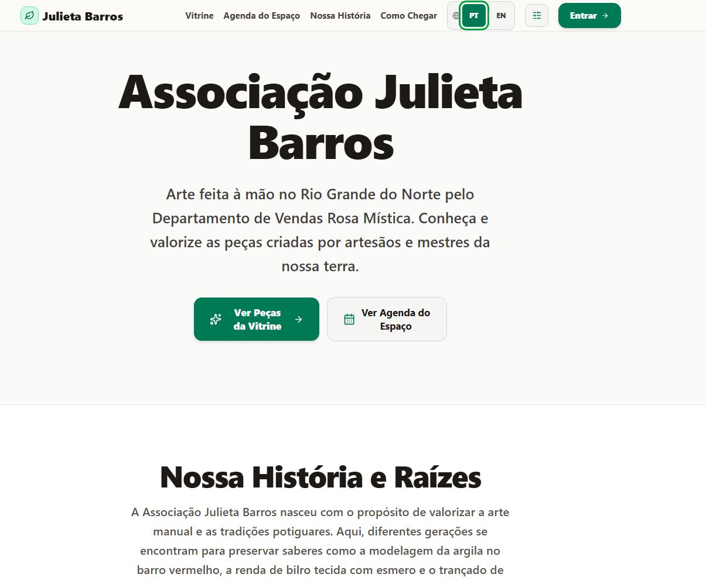

# Associacao Julieta Barros - Digital Showcase and Community Management

[Versao em Portugues](../../README.md)

Modern Single Page Application (SPA) developed for Associacao Julieta Barros and its Rosa Mistica Sales Department, located in the North Zone of Natal, RN, Brazil.

This project was built to empower local artisan cooperatives through an Online-to-Offline (O2O) model, prioritizing elderly accessibility, streamlined usability, and strict LGPD compliance (Brazilian General Data Protection Law).



---

## Table of Contents

- [Overview](#overview)
- [Technologies](#technologies)
- [Architecture and Compliance](#architecture-and-compliance)
- [Artificial Intelligence and Sustainability](#artificial-intelligence-and-sustainability)
- [Project Roadmap and Stages](#project-roadmap-and-stages)
- [Running Locally](#running-locally)
- [Available Scripts](#available-scripts)
- [Accessibility and Usability](#accessibility-and-usability)

---

## Overview

The application provides a digital storefront to display handcrafted goods and promote local community workshops. Purchasing negotiations take place in the physical workspace or via direct WhatsApp communication, minimizing transaction overhead and protecting customer personal data.

---

## Technologies

### Frontend
- React 19
- TypeScript
- Vite 6
- Tailwind CSS v4
- React Router v7
- Lucide React
- Framer Motion
- Vite PWA (Custom service worker and offline capability)

### Backend and Persistence (Target Architecture)
- Python with Django and Django REST Framework
- PostgreSQL (Official relational database)
- JWT and session-based authentication with Role-Based Access Control (RBAC)

---

## Architecture and Compliance

- Strict Decoupling: The frontend is fully static and communicates exclusively through standard JSON-based REST HTTP calls.
- LGPD by Design: No sensitive or unnecessary visitor data is stored on public endpoints.
- Relational Persistence: Entities (artisans, products, techniques, categories, and events) are modeled inside PostgreSQL, ensuring referential integrity, predictable query execution, and zero per-read document costs.

---

## Artificial Intelligence and Sustainability

- Artificial Intelligence Assistance: AI tools were leveraged to assist in rapid UI/UX prototyping, designing specialized accessibility features for older adults, streamlining O2O engagement flows, and scaffolding modular React components.
- Risk Mitigation Against Maintenance Absence: Community-driven initiatives often experience extended intervals without active technical teams for continuous software upkeep. Key architectural decisions were specifically driven to reduce this vulnerability:
  - Strict adherence to open web standards, eliminating reliance on closed proprietary ecosystems that could alter terms, deprecate endpoints, or introduce unforeseen operational fees.
  - Choosing PostgreSQL and Django relies on their multi-decade maturity, rock-solid stability, and exhaustive public documentation, ensuring any future volunteer or developer can inspect and maintain the software without vendor lock-in.
  - The decoupled frontend ensures the public digital showcase remains resilient, fast, and accessible even during backend maintenance intervals or under infrastructure constraints.
- Extended Project Lifecycle: The architecture prioritizes long-term software sustainability, effortless data backups, and low-footprint hosting, ensuring that the platform serves the artisan cooperative reliably for years with minimal maintenance demands.

---

## Project Roadmap and Stages

### Stage 1: UI/UX and Frontend Foundation (Completed)
- [x] Visual identity prototyping with a mobile-first approach.
- [x] Responsive product showcase with dynamic status tags (Available/Sold).
- [x] Action modals for direct contact with the cooperative or individual artisan.
- [x] Public community agenda for courses and workshops.
- [x] Multi-tier management dashboard (Producer, Manager, and Administrator).
- [x] Comprehensive accessibility suite (font resizing, high contrast, and text-to-speech).
- [x] PWA offline caching for catalog items and critical views.

### Stage 2: Backend and Database Implementation (Current Phase)
- [ ] Build the core REST API using Python, Django, and Django REST Framework.
- [ ] PostgreSQL database schema configuration and migrations:
  - User and Profile tables with RBAC enforcement (Admin, Manager, Artisan).
  - Product Catalog and Craft Technique models.
  - Workshops, Courses, and Community Event tables.
  - Audit logging system for administrative actions.
- [ ] Token-based JWT authentication and profile sync endpoints.
- [ ] Django Admin panel configuration for board members and coordinators.
- [ ] Media handling and storage configuration for product photography.

### Stage 3: Integration, Testing, and Deployment
- [ ] Connect frontend services (`src/services/djangoApi.ts`) with production Django endpoints.
- [ ] End-to-end verification of catalog approval pipelines and inventory toggles.
- [ ] Cloud deployment with dedicated PostgreSQL database hosting.
- [ ] Automated backup pipelines and continuous health check monitoring via `/api/health`.

---

## Running Locally

### Prerequisites
- Node.js (version 18 or higher)
- npm or equivalent package manager

### Steps

1. Install project dependencies:
   ```bash
   npm install
   ```

2. Start the development server:
   ```bash
   npm run dev
   ```

3. Open your browser at:
   ```text
   http://localhost:3000
   ```

---

## Available Scripts

- `npm run dev`: Starts the local development server with Hot Module Replacement.
- `npm run build`: Generates the production-optimized build in the `dist/` directory.
- `npm run preview`: Previews the production build locally.
- `npm run lint`: Validates TypeScript types without emitting output (`tsc --noEmit`).

---

## Accessibility and Usability

- Display modes: Light, Dark, and High Contrast.
- Typography: Dynamic font scaling and dyslexia-friendly font option.
- Text-to-speech: Web Speech API integration for screen reading support.
- Keyboard navigation: Full tab navigation support, modal focus traps, and descriptive screen reader announcements.
